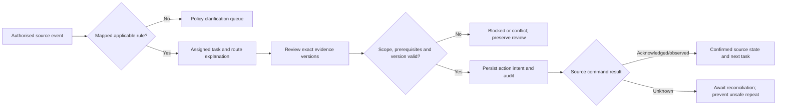

# Contextual workspace and console flows

Date: 25 October 2026 | Fidelity: text wireframes and interaction specification, no implemented UI

Journeys and scope: [MVP baseline](./mvp-scope.md). All names, IDs, counts, dates and findings below are illustrative synthetic content, not generated records or regulatory values.

## Navigation and common case frame

The existing host remains the entry point. Its selected case opens the contextual module after independent backend authorisation. Cross-case work opens a scoped console. No header/page identifier establishes entitlement. Keep source and service state visible without requiring an operations screen to understand a pending action.

```text
REFERENCE HOST — SYNTHETIC DATA                         [Open task panel]
Host case DEMO-CASE-01        Host source version 12

+---------------- Contextual case workspace ---------------------------+
| DEMO-CASE-01 | DEMO institution | DEMO Region | SYNTHETIC              |
| Source status: Awaiting scrutiny | Observed: 25 Oct 2026, 14:30 IST   |
| Service task: Review assigned | Rule: demo-2026-v1 | Sync: Fresh       |
| [Tasks] [Evidence] [Deadlines] [Readiness] [History]                    |
|                                                                     |
| Next action: assigned reviewer checks evidence version 2             |
| Due: confirmed demo target | Calendar age / stage age / policy age    |
| Blocker: report not yet accepted | Why: linked rule + evidence        |
| [Review evidence]  [Raise deficiency]  [View allowed next steps]       |
| Outcome/command receipt: none pending                                |
+---------------------------------------------------------------------+
```

Labels are product language, not a promise to expose raw engine identifiers to institutions. Show readable reasons with expandable rule/evidence/version references. In import mode, replace fresh-sync language with batch/export time, scope and an explicit read-only label. Do not present a general Approve button based on internal task completion.

## Flow 1 — Submission, routing and confirmed action



Action review shows the current source/service status, proposed change, evidence references and reason field where required. Submit returns a receipt. While pending, replace duplicate-submit with View receipt; do not simply disable every recovery/navigation action. Unknown outcome keeps inspection available and routes technical work to support. A conflicting version offers refresh and re-review rather than overwriting another official's action.

## Flow 2 — Deficiency and versioned response

```text
INSTITUTION / Required action                         SYNTHETIC
Deficiency DEMO-D-01 | permitted correction scope | original finding
Required evidence: [checklist] | Due basis: [confirmed rule/order]
Current response: partial | New file: quarantined / safe / rejected
[Save permitted draft] [Submit partial] [Submit complete response]

REVIEWER / Re-review iteration 2
Prior iteration: [findings + evidence v1 + outcome]
Current submission: [receipt] [evidence v2] | Verification: pending
[Request clarification] [Record recommendation] [Permitted return]
Reason: [required for deficiency/return] | [Review action] [Submit]
```

Submission confirmation states received, not compliant. Complete submission creates re-review only if allowed prerequisites are met. A negative recommendation is labelled as such; official decision remains separate. No arbitrary source-fact edit control is introduced. Preserve focus, form validation and entered reasons on conflict without submitting stale facts.

## Flow 3 — EVC scheduling and recovery planner

```text
EVC CONSOLE / Region scope                           SYNTHETIC
Queues: Eligible | Blocked | Confirmed | Conducted | Report pending
Case       Readiness       Selection/constraints      Next action
DEMO-03    Review pending  Authorised demo committee   Complete review
DEMO-07    Ready           Availability conflict       Inspect plan

CASE READINESS / Recovery proposal
Data: observed time + versions | Assumptions: review outcome, durations
                  Baseline      Alternative A      Alternative B
Target slack      late          improved            unknown/missing data
Changes           none          permitted slot      not executable
Affected cases    none          listed              not evaluated
Hard constraints  satisfied     satisfied           missing inputs
[Inspect constraints] [Review permitted delta] [Approve and execute]
```

The execution button is available only to an authorised actor with fresh complete prerequisites. A contingent future slot remains visibly proposed until review permits confirmation. Distinguish optimal/feasible/late/infeasible/timeout/missing-data/model-invalid. Show affected confirmed bookings; preserve them unless the approved delta includes authorised changes. Separate Confirm slot, Record visit conducted and Record report/outcome actions.

## Flow 4 — Undertakings and evidence review

```text
INSTITUTION / Undertakings for synthetic source order
Condition       Due / original due    Submission       Verification
DEMO-OBL-A      03 Nov / 03 Nov        Received on time Awaiting reviewer
DEMO-OBL-B      10 Nov / 10 Nov        Not submitted    Not started
[Open source condition] [Evidence checklist] [Submit evidence]

VERIFIER / Condition DEMO-OBL-A
Source passage + due derivation | Assigned authority | Evidence v2
Submission receipt/time | Existing assessments | Current finding
[Accept version] [Not accept] [Request clarification]
[Request permitted extension: new due + reason + authority]
```

Sort/filter lifecycle and timeliness independently. Timely submitted evidence awaiting review is not a missing submission. An extension displays original/current due and audit reference; it does not delete late history. Partial acceptance cannot close unrelated conditions. Link through to receipt, assessed version and original order, including after approval-processing closure.

## Flow 5 — Validity, renewal and escalation

```text
DOCUMENT / DEMO lease                              SYNTHETIC
Accepted: version 1 | Expiry: [date] | Required demo horizon: [date]
Finding: current expiry / insufficient horizon / unknown applicability
Renewal: version 2 received | Scan safe | Verification pending
Pending action: assigned verifier | Source freshness: [observed time]
[Open accepted version] [Open renewal receipt] [Inspect rule finding]

NOTIFICATION HISTORY
Missing-submission notice: cancelled before dispatch after receipt check
Verification follow-up: queued for assigned role
Email attempt: provider accepted / delivered only with receipt / unknown
Technical delivery issue: operations action, not institutional violation
```

Keep the old accepted version and unresolved validity finding until verification accepts the replacement. Upload and review receipts are separately visible. Notice cancellation preserves history. If dispatch occurred first, show actual ordering rather than pretending the notice was recalled. No expiry or alert control becomes an automatic sanction.

## Console, reporting and audit flows

```text
SCOPED CONSOLE / Officer, Region or Bureau mandate     SYNTHETIC
[Region] [Stage] [Category] [Responsible role] [Reference time]
Pending applications | Pending tasks | Open obligations | Pending visits
Oldest / due / overdue | Delay categories | Median/p90 + sample count
Data source: event observation / imported batch | Projection updated at
Stage or blocker row -> authorised case list -> contextual workspace

[Pendency] [EVC] [Undertakings] [Validity] [Overdue] [Region report]
Generate -> report receipt -> status -> scoped download
Metadata: reference time, scope, filters, definition version, freshness

CASE HISTORY
Time | Actor/service | Action/outcome | Reason/authority | Versions
Event -> source receipt -> policy + reviewed evidence -> next action
[Export within audit mandate] [Append permitted correction]
```

Institution and committee views limit their own scope and fields; Region/Bureau scopes require explicit assignments. Counts use distinct units, not a sum of tasks as applications. Safe export/download rechecks access even if a previously generated link exists. Source/version/evidence details are expandable and meaningful to the current role.

## Shared states and recovery copy

| State | User-facing content | Allowed action / recovery |
|---|---|---|
| Loading | Scope and loading status; no fabricated zeros | Cancel navigation if appropriate; actions await actual data |
| Empty | No matching work in the selected authorised scope | Adjust filters; do not imply all Regions have zero backlog |
| Blocked prerequisite | Specific missing review/evidence and responsible action | Inspect source/rule, complete own permitted work; no bypass |
| Unknown mapping/policy | Applicability not confirmed | Clarification queue; no guessed route/deadline |
| Stale source | Last successful source observation and limitation | Refresh/reconcile; read-only scenario inspection; no consequential execution |
| Version conflict | Another change occurred; submitted action was not applied | Refresh/re-review with preserved safe draft; never overwrite silently |
| Write outcome unknown | Source may have accepted action; receipt reconciliation pending | Inspect receipt; no unsafe repeated effective command |
| Evidence quarantined | Received, scan pending; not distributed or reviewed | Receipt/status; retry technical scan via operations, not regulatory acceptance |
| Evidence unverified | Submitted version pending official review | View receipt/assigned reviewer; no self-acceptance |
| Provider outcome unknown/failed | Communication status and technical follow-up | Safe provider reconciliation; do not label institution non-compliant |
| Denied/expired assignment | Access unavailable under current mandate | Non-disclosing error and authorised support route; no protected data |
| Runtime failure | What is known, correlation/receipt and retry safety | Safe retry only when confirmed not effective; preserve history |

Match freshness thresholds and command guards to the [integration contract](../discovery/integration-mode.md), not a browser timer. Every state uses text/icons in addition to colour. Keyboard order, labels, visible focus, screen-reader announcements, confirmation focus return and readable IST dates are core acceptance. Accessible tables have headers; dialogs identify their purpose. Validate the real UI later with manual keyboard/screen-reader walkthroughs; these wireframes alone establish no accessibility conformance.
