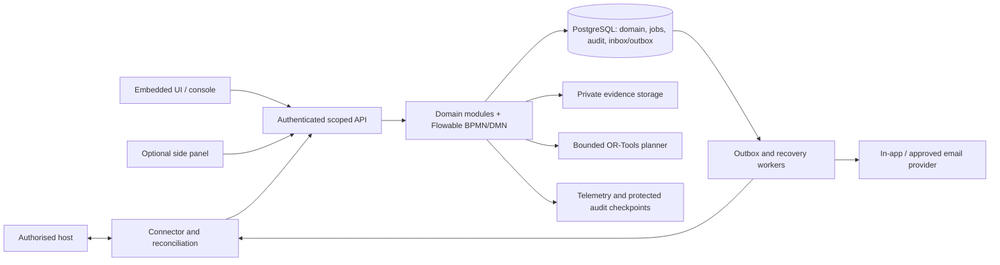

# Master PRD: Integrated AICTE Approval Workflow Automation, Compliance Monitoring and Alert Management

Version: 1.0 | Date: 25 October 2026 | Status: implementation baseline; regulatory and integration decisions pending owner validation

Companion delivery backlog: [tickets.md](./tickets.md). This document specifies the product; the backlog specifies deliverable work and dependencies. Neither document constitutes AICTE authorisation or an approved interpretation of regulations.

## 1. Product definition

Build an integration-first orchestration and compliance service around an existing authorised application system. It coordinates permitted application routes, human review tasks, EVC scheduling, undertakings, document validity, reminders, escalations, reporting and audit. A contextual task interface sits inside the host where possible; a small console supports cross-case operations and administration. An optional browser side panel supports approved legacy environments.

The server remains operational when every browser is closed. The existing host retains the official application facts and statutory decisions unless an explicit ownership agreement delegates particular functions. The service must distinguish its recommendations and internal state from acknowledged updates in the official source.

The flagship capability is **Case Readiness and Recovery Planning**: explain missing prerequisites, test feasible schedules under explicit assumptions and shared resource limits, and propose authorised interventions with evidence and rule references. An authorised person decides whether to act; the service revalidates current state before execution.

### 1.1 Problem and intended outcomes

The problem statement identifies coordination across Regions, stages, officials and institutions; stage pendency; EVC scheduling; conditional approvals; and expiring documents. The product should reduce repeated follow-up, expose the actual pending action, improve timeliness and preserve accountability. Actual savings require measurement in a consented pilot; no percentage reduction is assumed.

The supplied existing-workflow research indicates that application submission, committee formation and approval letters already have digital support. Current internal capabilities have not been independently established. Discovery must identify the actual operational gap rather than claim existing AICTE systems lack automation.

### 1.2 Governing invariants

1. Task completion, a favourable recommendation and a statutory decision are separate events.
2. Evidence submission, review and verified compliance are separate states.
3. SHC means Standing Hearing Committee; SAC means Standing Appellate Committee. They have different triggers and authority.
4. No universal scrutiny → EVC → SAC → approval route. Applicability comes from approved category-specific rules.
5. An overdue timer creates permitted follow-up, never an automatic sanction, cancellation or approval.
6. No unauthorised portal writes, credential harvesting, private-endpoint reverse engineering or unattended browser workaround.
7. Official deadlines, internal targets and estimated task durations are different concepts.
8. Policy ambiguity or stale source state blocks consequential automation and produces a clarification/reconciliation task.
9. All consequential actions are attributable, permission checked, version checked, retry safe and auditable.

## 2. Inputs, evidence and research decisions

All three supplied sources were read, including the Word document paragraphs and tables:

| Input | Contribution | Treatment |
|---|---|---|
| [AICTE_Workflow_Master_Context.md](./AICTE_Workflow_Master_Context.md) | Consolidated architecture, eight capability groups, planner, security and deployment | Primary product synthesis; preserve its explicit unknowns |
| [Workflow Automation Project context.docx](./Workflow%20Automation%20Project%20context.docx) | Detailed feature behaviour, negative cases, integration hierarchy and evaluation | Expanded into requirements and acceptance scenarios |
| [AICTE's existing approval workflow.docx](./AICTE%27s%20existing%20approval%20workflow.docx) | Existing process and stakeholder baseline | Contextual research, partly from older sources; not an executable rulebook |
| User-provided problem statement | A–F, outcomes, evaluation and regulatory safeguard | Mandatory scope and ultimate product intent |

Evidence labels throughout: **V** = verified source fact within stated scope; **P** = proposed product/design choice; **U** = unresolved owner/regulatory decision. All numerical service targets and synthetic scenarios are P.

### 2.1 Findings checked for this PRD

| Finding | Evidence/status | Product consequence |
|---|---|---|
| Base APH uses application-category routes; SAC/SHC involvement is conditional | V, R1, Table 2.3, printed p.30 / PDF p.46 | Versioned routing table; preserve hearing and appeal distinctions |
| Base APH contains live-lease requirements related to course duration | V, R1, clause 2.2(e), printed p.12; section 6.1.1(a), printed p.56 | Support applicability, remaining validity and event horizon; owner resolves exact interpretation |
| Full current amendments and annual instructions are not confirmed | U; R2 updated PDF returned HTTP 404 on 25 October 2026 | Regulatory publication gate; do not activate base text as exhaustive current policy |
| Older workflow notes describe annual EoA and particular visit modes | Supplied research only; base handbook also describes longer EoA for eligible institutions | Approval period, visit mode and renewal frequency must be configured, not universalised |
| Supported AICTE APIs, write delegation and event feeds have not been established | U | Reference-host prototype or sanctioned adapter; no invented AICTE contract |
| Flowable documents persistent timer jobs and dead-letter handling | V, R3 | Suitable default durable workflow engine, subject to compatibility spike |
| OR-Tools demonstrates precedence and exclusive resource constraints | V, R4 | Suitable scheduling foundation; AICTE constraints remain separately validated |
| Extension workers may terminate | V, R5 | All authoritative timers stay on the server |
| DPDP commencement is staged | V, R6 | Deployment-specific applicability matrix, reviewed again at release |

The old notes' statements about signatures, hearings, selection methods, visits, approval periods and appeal windows are not silently promoted to universal policy. Capture their applicable source and year in the approved register first. A researched base-handbook rule is not equivalent to a production-authorised rule.

### 2.2 Primary-source register

Checked means the source was opened during this PRD task. Inherited means cited by the supplied research and retained for engineering follow-up; it was not independently revalidated here.

| ID | Source | Verification/use |
|---|---|---|
| R1 | [AICTE APH 2024–2027, government-hosted copy](https://cdnbbsr.s3waas.gov.in/s35938b4d054136e5d59ada6ec9c295d7a/uploads/2025/03/2025031399.pdf) | Checked: base routing and lease concepts; not a consolidated amended corpus |
| R2 | [AICTE approval-process page](https://aicte.gov.in/approal-process-2026-2027), [updated addendum endpoint](https://aicte.gov.in/downloads/aph/Final%20Addendum%202026-27_Updated.pdf) | Page inherited; updated PDF fetch failed, 404; current authoritative replacement required |
| R3 | [Flowable asynchronous execution and persistent timers](https://www.flowable.com/open-source/docs/bpmn/ch18-Advanced/), [OSS introduction](https://www.flowable.com/open-source/docs/oss-introduction) | Timer documentation checked; licensing reference inherited; confirm selected versions/components |
| R4 | [OR-Tools job-shop scheduling](https://developers.google.com/optimization/scheduling/job_shop), [employee scheduling](https://developers.google.com/optimization/scheduling/employee_scheduling) | Job-shop checked; employee scheduling inherited; supports general algorithm design |
| R5 | [Chrome worker lifecycle](https://developer.chrome.com/docs/extensions/develop/concepts/service-workers/lifecycle), [sidePanel](https://developer.chrome.com/docs/extensions/reference/api/sidePanel), [activeTab](https://developer.chrome.com/docs/extensions/develop/concepts/activeTab) | Lifecycle checked; interface/permissions references inherited |
| R6 | [DPDP commencement notification, 13 November 2025](https://www.meity.gov.in/static/uploads/2025/11/c56ceae6c383460ca69577428d36828b.pdf) | Checked; applicability must be determined for actual deployment date |
| R7 | [CERT-In Directions, 28 April 2022](https://www.cert-in.org.in/PDF/CERT-In_Directions_70B_28.04.2022.pdf) | Checked; covered entities have incident/log obligations; security logs and official records need separate policies |
| R8 | [AWS transactional outbox](https://docs.aws.amazon.com/prescriptive-guidance/latest/cloud-design-patterns/transactional-outbox.html), [SQS at-least-once delivery](https://docs.aws.amazon.com/AWSSimpleQueueService/latest/SQSDeveloperGuide/standard-queues-at-least-once-delivery.html) | Inherited; reliability implementation references |
| R9 | [OWASP logging](https://cheatsheetseries.owasp.org/cheatsheets/Logging_Cheat_Sheet.html), [file uploads](https://cheatsheetseries.owasp.org/cheatsheets/File_Upload_Cheat_Sheet.html), [SSRF](https://cheatsheetseries.owasp.org/cheatsheets/Server_Side_Request_Forgery_Prevention_Cheat_Sheet.html) | Inherited; security baseline |
| R10 | [OAuth security BCP, RFC 9700](https://www.rfc-editor.org/rfc/rfc9700.html), [CloudEvents event identity](https://cloudevents.github.io/sdk-javascript/interfaces/CloudEventV1.html) | Inherited; identity/integration contract design |
| R11 | [WCAG 2.2](https://www.w3.org/TR/WCAG22/), [NIC MeghRaj](https://cloud.gov.in/user/about.php), [MeitY AMBUD](https://www.ambud.meity.gov.in/) | Inherited; accessibility benchmark and hosting discovery |
| R12 | [Process conformance foundations](https://www.processmining.org/conformance.html), [S3 Object Lock](https://docs.aws.amazon.com/AmazonS3/latest/userguide/object-lock.html) | Inherited; evaluation and protected audit design |

If a source moves or conflicts with a later instruction, retain its provenance, mark the rule unresolved and obtain an authorised replacement. Do not infer supersession from a newer download filename alone.

## 3. Users, permissions and responsibilities

Role names are provisional mappings to the owner's actual designations. Permission equals role **and** institution/campus, Region, assignment, committee membership, action scope and effective assignment dates. Enforce on APIs, queries, downloads, aggregates, exports and background jobs.

| Persona | Main job | Allowed scope |
|---|---|---|
| Institution authorised representative | Respond to deficiencies, submit compliance and renewals, inspect own deadlines | Own authorised institutions/campuses; no official verification |
| Scrutiny/re-scrutiny reviewer | Review assigned evidence and record findings/outcomes | Assigned cases and configured review actions |
| Regional officer/coordinator | Manage regional queues, assignments and permitted EVC coordination | Delegated Region and authority scope |
| EVC member/coordinator | View visit packs, confirm permitted availability, record assigned reports | Active committee assignments only |
| SHC/SAC member | Perform the applicable hearing/appeal work | Assigned branch and committee mandate |
| Bureau/competent authority | Oversight, authorised decisions and escalation response | Delegated cross-region/action scope |
| Compliance verifier | Review undertaking evidence and document replacements | Assigned obligations/documents |
| Policy author and publisher | Draft and approve executable configuration | Separate capabilities; separation of duties where required |
| Auditor | Reconstruct case and control history | Read/export within explicit audit mandate |
| Technical operator | Service recovery, connector health and incident handling | Operational metadata; no implicit regulatory decision power |

### 3.1 Permission matrix

`Own`, `Assigned`, `Region`, `Delegated`, `Mandate` are scope limits, not unrestricted grants. Every write also requires an enabled policy action.

| Action | Institution | Reviewer/verifier | Regional officer | Committee | Competent authority | Policy author/publisher | Auditor | Operator |
|---|---|---|---|---|---|---|---|---|
| Read case/evidence | Own | Assigned | Region | Assigned | Delegated | Sanitised fixtures | Mandate | Metadata by default |
| Submit correction/compliance | Own | — | — | — | — | — | — | — |
| Verify evidence/record recommendation | — | Assigned | Only if delegated | Assigned mandate | Delegated | — | — | — |
| Return/revert/reassign | — | Explicit delegated action | Region/action scope | Explicit mandate | Delegated | — | — | — |
| Confirm EVC schedule | Permitted availability only | — | Delegated | Delegated coordinator | Delegated | — | — | — |
| Record final statutory decision | — | — | Only if competent | Recommendation only | Explicit decision mandate | — | — | — |
| Draft/publish policy | — | — | — | — | Separate policy grant | Author / separate publisher | Read history | Deploy approved artifact only |
| Export report/audit | Own summaries | Assigned | Region | Assigned summaries | Delegated | Policy history | Mandate | Operational report |
| Retry technical job | — | — | — | — | — | — | — | Safe retry/reconcile only |

Time-bound delegation preserves the original actor, delegate, authority, scope and expiry. Reassignment revokes future access as configured without rewriting historical ownership. Emergency access is explicit, time limited and audited.

## 4. Scope and delivery boundaries

### 4.1 Release definitions

| Release | Included | Exit boundary |
|---|---|---|
| P0 prototype | Integration discovery; reference-host fallback; three configured routes, deficiency loop and conditional hearing/appeal; scoped dashboards; durable deadlines; bounded EVC scheduling; obligations; document validity/renewal; in-app + test email; reports; audit; bounded readiness/recovery planner; deployable demonstration | Synthetic data or explicitly authorised data; no production claims |
| P1 pilot hardening | Real host onboarding if authorised; compound requests; policy impact preview/migration; richer calendars/selection constraints; protected audit checkpoints; reproducible retained snapshots; second adapter; resilience and operational readiness | Approved pilot scope, policy register, identity, security and operations gates |
| P2 measured expansion | Additional sanctioned connectors/channels, validated duration models, deeper conformance analysis, assisted OCR/obligation extraction, optional extension where needed | Evidence of utility, approved data processing and support capacity |

The prototype implements all PS functional areas at bounded scale. P1 strengthens depth rather than deferring essential timer reliability, access isolation or audit until later. Basic policy author/reviewer publication and immutable versions are P0; bulk impact simulation and migration tooling are P1. Basic immutable report output is P0; retained reproducible analytical snapshots are P1. A signed-checkpoint demonstration can be staged during P0 evaluation; independently managed key custody is P1.

P0 three-route configuration: scrutiny-only; scrutiny + EVC; EVC-only. Include applicable conditional SHC/SAC branches without making them mandatory. Category bindings remain labelled synthetic until validated. Read-only import mode demonstrates monitoring; a reference host with an explicit test write contract demonstrates routing/writeback.

### 4.2 Out of scope

Replacing the official application/fee portal; autonomous regulatory decisions; forgery certification; universal website automation; real-time claims over batch imports; automatic punitive action; chatbot-first navigation; blockchain; production ML risk probabilities without validation; and production government deployment without owner approval. Official letters may be linked/imported; generated case summaries or communication drafts do not become official orders without the required process.

### 4.3 Integration modes

| Capability | Supported behaviour | Boundary shown to user |
|---|---|---|
| API/events/SSO + embedding | Event-driven coordination, contextual UI, delegated writes | Source acknowledgement and freshness visible |
| Supported read API + polling | Monitoring and proposals; supported writes only | Poll interval, last successful sync and lag |
| Validated CSV/JSON exports | Preview/import and monitoring | Batch timestamp, provenance and coverage |
| Owner-approved extension | Contextual assistance and links | Visible-page context is untrusted; no global visibility guarantee |
| Attended RPA | P2 exception only with explicit authority | Confirmation and reconciliation; no atomic-write guarantee |

## 5. User journeys and interface requirements

### 5.1 End-to-end case journey

1. A host submission event arrives with institution, category, academic year and source version. The connector validates and maps it; unknown mappings enter an exception queue.
2. The rule evaluator selects an approved applicable route, records its explanation and creates the first permitted human task. An unresolved category creates a policy clarification task.
3. The reviewer examines the exact evidence versions, records an outcome, or raises identified deficiencies with reasons. No arbitrary edit of submitted facts is enabled.
4. The institution sees the requested action, due basis and evidence checklist; submits a response; the configured re-review iteration begins. Submitted evidence awaits verification.
5. Where applicable, the EVC queue receives an eligible case. An authorised committee/selection result is preserved; feasible slots are proposed and confirmed under configured constraints.
6. Visit, report submission and authorised outcome are recorded separately. Any hearing/appeal follows its own trigger and mandate.
7. The competent authority's official decision is imported or recorded through a delegated contract. Case processing may close while post-approval obligations remain open.
8. Undertakings and document validity continue to generate scoped tasks, reminders and escalations. Verification resolves only the corresponding dependencies.

### 5.2 Recovery-planning journey

An officer opens a blocked case. The panel shows accepted evidence, pending review, rule version and sync age. The planner builds a baseline and permitted alternative schedule, showing assumptions and affected cases. An ineligible expert is excluded; a later but feasible schedule is labelled late. The officer selects a proposal; changed calendars or source versions invalidate it before execution. Successful execution requires a connector receipt, not merely a green UI toast.

### 5.3 Renewal and escalation journey

An institution submits a renewal just before a reminder. The system records receipt, cancels unsent missing-submission reminders at dispatch recheck, and creates verifier work. The existing accepted document remains in effect until its own expiry or the replacement is accepted. If that original document expires during review, the validity issue remains visible, while responsibility for the next verification action is correctly assigned.

### 5.4 Required surfaces

| Surface | Required content/actions |
|---|---|
| Embedded case workspace | Host/source ID, official vs orchestration status, tasks, blockers, deadlines, rule explanation, source freshness, authorised actions, evidence versions and timeline |
| Institution workspace | Own next actions, deficiency response, undertaking evidence, renewals, receipts and delivery history |
| Officer/Region/Bureau dashboards | Scoped queues, oldest work, due/overdue, stage distribution, drill-down, assignment/capacity context |
| EVC workspace | Eligibility queue, authorised committee, availability/constraints, proposed/confirmed slots, cancellation and report-pending state |
| Planner | Baseline/alternatives, assumptions, confidence limits, infeasibility/unknown distinction, affected bookings and controlled execution |
| Policy console | Rule register, draft/review/publish, effective dates, sources; P1 impact/migration preview |
| Operations console | Sync age, quarantined events, unknown writebacks, timer lag, job failures and reconciliation |
| Reporting/audit | Scoped report requests, immutable output metadata, protected evidence manifest and correlated history |

All lists require pagination, scoped filters, shareable authorised filter URLs and explicit empty/loading/error/stale states. Forms preserve drafts safely, prevent duplicate submissions, explain validation and show a durable action receipt. Status uses text/icons as well as colour. Display dates such as `25 Oct 2026, 14:30 IST`; store UTC instants and original date-only values separately. Do not display invented expiry dates for unknown values.

## 6. Functional requirement catalogue

Each ID is stable. Acceptance below is mandatory behaviour, with cross-cutting tests in section 14. Priorities indicate first complete release.

| ID | Priority | Requirement and acceptance evidence |
|---|---|---|
| INT-01 | P0 | Inventory host ownership, authority and capabilities; publish field-level source-of-truth matrix and enabled modes. Unsupported write controls remain disabled. |
| INT-02 | P0 | Authenticated, schema-validated event/poll/import ingestion with provenance. Duplicates create no extra task; late events cannot roll back a newer source projection. |
| INT-03 | P0 | Delegated commands carry expected version, actor/authority, correlation and idempotency key. Unknown outcomes remain pending reconciliation; no blind retry of effective writes. |
| INT-04 | P0 | Periodic reconciliation, sync health, mapping quarantine and explicit freshness. Stale sources block consequential source writes/planner execution. |
| INT-05 | P1 | Second structurally different host adapter passes the same contract suite without domain-engine forks. |
| IAM-01 | P0 | Federated identity where available, backend role/attribute checks and scope-limited evidence access. Cross-institution, Region and assignment attempts are denied. |
| IAM-02 | P0 | Expiring delegation, privileged MFA, policy author/publisher separation and audited access changes. Technical operators cannot decide cases. |
| POL-01 | P0 | Source-linked versioned rule register and reviewed publication; incomplete/conflicting applicability cannot be activated. Every route/clock references its evaluated version. |
| POL-02 | P1 | Preview affected cases and explicitly approve migration; failed migration retains recoverable prior state and records per-case results. |
| WF-01 | P0 | Execute the three route templates and conditional branches using category/year/policy/outcome inputs; show next role, prerequisites and explanation. |
| WF-02 | P0 | Enforce state/evidence/authority guards, deficiency IDs and iteration-specific re-review; return/revert requires reason and permitted scope. |
| WF-03 | P0 | Record recommendation and official decision separately; support authorised hold, withdrawal, transfer, negative outcome and closure. Post-approval monitoring survives case closure. |
| WF-04 | P1 | Linked requests/subcases and shared evidence; aggregate readiness follows configured joins, never arbitrary category precedence. |
| WF-05 | P0 | Produce versioned case summaries and permitted standard communication drafts with provenance; no generated text automatically becomes an official decision. |
| CLK-01 | P0 | Persist deadline derivation, calendar/version, anchor, source, original/current due and pause authority; calendar age never disappears. |
| CLK-02 | P0 | Durable timer recovery, extensions and cancellation; deterministic boundary tests and restart recovery produce no duplicate domain escalation. |
| EVC-01 | P0 | Queue only eligible cases; track selection authority, proposal, confirmation, conduct, report and outcome independently. Scheduling a visit does not complete EVC. |
| EVC-02 | P0 | Enforce supplied composition, exclusions, availability, prerequisites and non-overlap; preserve prescribed selection method. Solver returns feasible/infeasible/unknown/missing-data distinctly. |
| EVC-03 | P1 | Rich travel/mode calendars, cancellation recovery and minimal-disruption rescheduling; confirmed bookings cannot be displaced without authority. |
| CMP-01 | P0 | One obligation per condition, linked to order/source passage, due basis, evidence checklist, institution and verifier. Ambiguous dates require confirmation. |
| CMP-02 | P0 | Version-specific review, clarification/rejection/resubmission, authorised extension and acceptance. Timely submitted evidence is not classified as missing while awaiting review. |
| DOC-01 | P0 | Scoped document/version register with effective/expiry dates, provenance, applicability, accepted version and review history; unknown/no-expiry cases supported. |
| DOC-02 | P0 | Evaluate expiry, remaining validity and configured event horizon separately; a valid but insufficient lease produces an explainable finding. |
| DOC-03 | P0 | Quarantined secure upload and renewal review; replacement acceptance re-evaluates only dependent findings/tasks and preserves earlier evidence. |
| ALT-01 | P0 | Versioned trigger/offset/recipient/channel/repeat/template/resolution rules; in-app plus test-email channel. All intervals labelled synthetic until approved. |
| ALT-02 | P0 | Transactional outbox, persistent jobs, dispatch recheck, logical deduplication and bounded retries. Provider acceptance/delivery/read are separate. |
| ALT-03 | P0 | Escalate the current pending action to configured authority; institution, reviewer, committee and integration waits remain distinct. Failed delivery alerts operations. |
| DSH-01 | P0 | Institution, officer, Region, Bureau and committee views with scoped counts, stage/queue age, calendar/policy age and visible freshness. |
| DSH-02 | P0 | Explain bottlenecks from recorded blockers; median/p90 and workload context; aggregate-to-case reconciliation over seeded known totals. |
| RPT-01 | P0 | Pendency, EVC, undertakings, validity, overdue and regional reports with reference time, filters, scope, definitions and source freshness; safe CSV export. |
| RPT-02 | P1 | Retained analytical snapshots and metric versions reproduce historical output including transfer/reopening semantics. |
| AUD-01 | P0 | Append-only correlated actions, assignments, evidence review, deadlines, policy, alerts, escalations, decisions and sensitive access/export; correction through new events. |
| AUD-02 | P1 | Independently protected signed checkpoints and verification detect supported alteration/deletion cases; state limitations of privileged-compromise protection. |
| PLN-01 | P0 | Explain readiness from rules, prerequisites, evidence and source freshness; missing information is explicit and suppresses execution. |
| PLN-02 | P0 | Resource-aware baseline/what-if schedules, slack, assumptions and transparent objective; uncertainty and unresolved outcome branches displayed. |
| PLN-03 | P0 | Review/approve proposal with expected versions and permission/constraint recheck; expired/stale proposals rejected and recomputed. |
| PLN-04 | P0 | Controlled FIFO, earliest-deadline-first, dependency-only and full-planner evaluation with fixed constraints, held-out seeds and no unsupported novelty/savings claim. |
| AI-01 | P2 | Optional OCR/LLM drafts with passage references, structured validation and human confirmation; no tool/decision authority from uploaded text. |
| UX-01 | P0 | Accessible contextual interface and console; keyboard/screen-reader, non-colour states, readable IST dates and accessible evidence workflow. |
| UX-02 | P2 | Optional allowlisted Chromium side panel with independent authentication, least permissions, packaged adapters and safe stop on page changes. |
| OPS-01 | P0 | Reproducible local/staging deployment, secrets isolation, migrations, backups/restoration, telemetry and incident/recovery runbooks. |
| OPS-02 | P1 | Approved managed hosting, measurable recovery/service targets, retention/legal holds, disaster and credential-rotation drills. |

## 7. State models and transition rules

These are product-level semantic states, not claimed existing AICTE portal statuses. Connectors maintain explicit mappings. Application status, task status, official decision and compliance status must be separate fields.

### 7.1 Case and task transitions

| From/event | Result | Guard and recorded facts |
|---|---|---|
| Source submission received | Observed → Route pending | Valid mapping, provenance, source version and scope |
| Applicable approved rule found | Route pending → Active + first task | Record evaluated policy, explanation and route definition |
| Missing/conflicting applicability | Route pending → Policy clarification | No guessed route or invented deadline |
| Active task completed | Outcome recorded → next permitted task or decision pending | Required evidence, authorised outcome; favourable outcome not inferred |
| Deficiency/clarification raised | Response pending | Deficiency IDs, allowed correction scope, reason and deadline basis |
| Response received | Re-review iteration queued | Preserve earlier findings and exact evidence versions |
| Return/revert requested | Permitted prior-stage task created | Authorised edge, reason, scope and superseded task references |
| Hearing/appeal trigger | SHC or SAC branch | Applicable rule and authorised invocation, separately modelled |
| Final official decision observed/acknowledged | Decision recorded → approval-processing closed where applicable | Competent authority, order reference, source receipt; obligations continue |
| Hold/withdraw/transfer/reopen | Explicit lifecycle event | Rule-authorised effect on tasks/clocks; historic ownership retained |

Task status: `queued → assigned → in_progress → outcome_recorded`; additional `waiting_response`, `blocked`, `cancelled` and `superseded` states carry reasons. A re-review is a new iteration, not an overwrite. Case closure and obligation closure are independent.

### 7.2 Other state machines

| Entity | Lifecycle | Important exceptions |
|---|---|---|
| EVC | Eligible → Awaiting scheduling → Proposed → Confirmed → Conducted → Report pending → Outcome recorded | Cancellation/rescheduling preserve booking history; report receipt alone is not authorised outcome |
| Obligation | Draft → Open → Evidence submitted → Under review → Accepted | Clarification required / Not accepted → allowed resubmission; withdrawal only with authority |
| Renewal | Required → Notified → Submitted → Under review → Accepted | Rejected/clarification; accepted original remains linked; expiry tracked independently |
| Policy | Draft → Reviewed → Approved → Effective → Retired | Scheduled effective date; withdrawal before activation; controlled migration of active cases |
| Proposal | Drafted → Reviewed → Approved → Execution requested → Confirmed | Stale/expired/rejected/unknown outcome; partial multi-action execution visible |
| Notification | Scheduled → Eligible → Queued → Dispatching → Provider accepted | Delivered only with supported receipt; cancelled/failed/delivery unknown separate |
| Source command | Intent recorded → Sent → Acknowledged → Confirmed | Rejected, conflict, failed-safe-to-retry or outcome unknown → reconciliation |

Timeliness is orthogonal to lifecycle: due soon, on time, late, no submission overdue, review pending and resolved after due. Acceptance must not erase a late submission or original deadline.

## 8. Rules, deadline semantics and metrics

### 8.1 Rule register and governance

Each rule stores ID/version, policy bundle, source document/checksum, clause/printed page, publication/effective dates, academic year/category/institution applicability, supersedes relationship, interpretation notes, author, reviewer, publisher and fixtures. Missing source or applicability blocks production publication. Demo bundles use a conspicuous `SYNTHETIC_NOT_REGULATORY` marker.

Before activation validate overlapping effective ranges, unreachable transitions, missing recipient roles, calendars, invalid offsets and undefined outcomes. Published versions are immutable. Cases record evaluated versions. Urgent policy changes may require migration; P0 permits an explicitly reviewed limited migration procedure, while P1 adds bulk impact tooling. No implicit retroactive rewrite. Maker-checker exceptions require an approved recorded policy, never the author's convenience.

### 8.2 Clock contract

Store deadline type (`regulatory`, `order-specific`, `internal-target`), anchor event/version, offset or fixed due date, calendar/date inclusivity, time zone, cutoff, source rule, original/current due, extension history and allowed pause intervals. Store date-only inputs as dates rather than assuming midnight UTC. Server time is authoritative for receipt/dispatch; observed host timestamps remain separate and labelled.

For the synthetic prototype, date-only deadlines are inclusive through the local date: calculate `overdue_at` as the start of the following date in Asia/Kolkata and classify overdue at `now >= overdue_at`. Working-day offsets exclude the anchor date, skip configured non-working days and retain the approved local cutoff. These are demo conventions, replaceable only through an approved calendar/rule version. External event occurrence and evidence-receipt timeliness use the owner-approved authoritative timestamp; delayed ingestion cannot silently convert a timely official submission into late submission.

Calendar age always advances. Policy-clock elapsed time may subtract only authorised pause intervals. An extension preserves original due, current due, actor, reason, authority and timer-generation version; obsolete unsent jobs are invalidated atomically. Transfers/reassignment do not reset clocks unless the rule expressly permits it. No deadline present means `not configured`, not zero days overdue. Multi-year obligations remain persisted and survive annual application cycles.

### 8.3 Metric dictionary

| Metric | Definition/qualification |
|---|---|
| Pending applications | Distinct active approval-processing cases at reference time; post-approval obligations counted separately |
| Pending tasks / obligations / visits | Separate entity counts; never added together as application count |
| Application calendar age | Reference time minus valid source submission time, with missing/uncertain timestamps flagged |
| Current-stage/iteration age | Elapsed since entry into that iteration; prior iterations retained |
| Queue / response / review elapsed | Defined event intervals; report elapsed duration, not inferred human effort |
| Policy-clock age | Applicable elapsed calendar/working time minus permitted pauses |
| Overdue | Unresolved action after its approved boundary; show responsible pending action and due basis |
| Backlog movement | Opening + arrivals + reopened + transfers in − processing closures − withdrawals − transfers out |
| Period completions | Entry into defined processing-closure state in period; separate approvals, refusals and other outcomes |
| Cohort completion | Share of a defined submitted cohort closed by reference time; denominator and exclusions recorded |
| On-time completion | Eligible tasks completed within applicable due boundary; original/current deadline views available |
| Rework | Count defined return/re-review iterations; do not count technical retries |
| Distribution | Median/p90 by comparable category/stage; disclose sample size and exclusions |

For simultaneous tasks, delay categories may overlap. Show intervals and avoid summing overlapping waits into an inflated total. Reports record period `[start, end)`, reference time, definition version, scope and ownership-at-time convention. Historical output cannot be rewritten when a user changes Region.

## 9. Case Readiness and Recovery Planner

### 9.1 Inputs and output contract

Inputs: applicable rule/workflow versions; source versions and freshness; confirmed task outcomes; evidence submitted/accepted states; instantiated remaining tasks; branch assumptions; approved resource calendars and committee selection results; durations; hard deadlines; internal targets and allowed interventions.

Output: readiness (`ready`, `blocked`, `unknown`), missing prerequisites with evidence/rule links; baseline schedule; bounded alternatives; earliest/finish estimates; target slack; affected cases/bookings; objective values; assumptions; solver status/runtime; model/data versions and proposal expiry. No approval likelihood or uncalibrated probability is shown.

### 9.2 Algorithm and constraints

1. Validate permissions, mappings and freshness; return missing-data findings before optimisation.
2. Evaluate permitted next transitions and evidence-dependent blockers.
3. Instantiate remaining task nodes for each bounded supported scenario. Re-scrutiny loops create iteration nodes; the complete cyclic workflow is not flattened into a universal DAG.
4. Calculate precedence-only earliest bounds using approved calendars and explicitly assumed durations.
5. Use OR-Tools CP-SAT intervals, precedence and non-overlap/capacity constraints for shared resources and permitted slots. Preserve authorised committee selection. Do not optimise away mandatory randomisation/composition.
6. Freeze confirmed bookings unless a proposed intervention expressly includes an authorised change. Proposed future slots contingent on review cannot be presented as immediately executable confirmed bookings.
7. Optimise a documented, versioned objective: weighted lateness first, then disruption and workload as tie-breakers. Weights are product policy, not legal priority. An approved priority must never be replaced by institutional favouritism.
8. Return baseline and alternatives, assumptions and blockers. Hard constraints never relax silently. A feasible late plan remains distinct from no feasible schedule within the planning horizon.
9. Approver reviews the delta and effects on other cases. Recheck source/calendar/policy/assignment versions and prerequisites immediately before a transactionally reserved slot and delegated command.
10. Record proposal, approval, command receipts and outcome. Where multiple host writes are not atomic, record each step and reconcile partial outcomes rather than claiming all-or-nothing execution.

Statuses: `OPTIMAL`, `FEASIBLE`, `INFEASIBLE`, `UNKNOWN_TIMEOUT`, `MODEL_INVALID`, `MISSING_DATA`. A feasible result is not necessarily optimal. Infeasibility means under the declared model/horizon; timeout means no conclusion. Blocking subsets may be explanatory, not mathematically minimal unless actually computed.

### 9.3 P0 bounds and assumptions

Proposed benchmark: up to 50 planning cases, 20 experts, 30 local working days and at most three labelled remaining-route scenarios per case. Five-second solver budget per scenario is a target; expose partial feasible results or timeout. Default duration inputs are explicit synthetic configuration. Do not train duration models during P0. The prototype must show a readiness blocker, shared EVC capacity conflict, feasible alternative, disallowed alternative and stale-proposal rejection.

### 9.4 Evaluation

Run FIFO + reminders, earliest-deadline-first, dependency-aware planning without shared-resource optimisation, and the full planner against identical initial workloads, constraints, permitted actions and duration assumptions. Deterministic seeds, held-out workloads, repeated runs and raw outputs are retained. Compare late tasks, weighted lateness, hard-constraint violations, disruption, workload balance, runtime and reviewer-rated explanation correctness. Optional cancellation benchmark compares first-available allocation. Report constraint violations as defects, never acceptable improvement trade-offs. Synthetic improvements demonstrate model behaviour, not actual AICTE operational savings or patent novelty.

## 10. Data and API design

### 10.1 Core entities

| Group | Entities and essential facts |
|---|---|
| Organisation/identity | Institution, Campus, Region, UserAssignment, Delegation: external IDs, scope, effective interval and authority |
| Case/source | Application, ApplicationRequest, SourceLink: category/year, official and observed versions, source status, orchestration status, provenance and freshness |
| Policy/execution | PolicyBundle, RuleVersion, WorkflowDefinitionVersion, WorkflowInstance, TaskInstance, Deficiency: effective applicability, iteration, outcome, guards and explanation |
| EVC/resources | Committee, ExpertEligibility, SelectionRecord, Availability, Visit, BookingVersion: mandate, eligibility/exclusions, authorisation, slot and visit/report outcomes |
| Compliance/evidence | ApprovalOrder, Obligation, EvidenceSubmission, Document, DocumentVersion, ValidityFinding: source passage, required evidence, exact reviewed version, accepted replacement and dependency links |
| Time/communication | Deadline, CalendarVersion, Pause, Extension, NotificationRule, ScheduledNotice, NotificationAttempt, Escalation: due derivation, timer generation, recipient and delivery state |
| Integration/reliability | IntegrationEvent, InboxReceipt, OutboxEntry, CommandReceipt, SyncCursor, ReconciliationRun: dedup keys, source version, state, retries and ambiguity |
| Planning/reporting/audit | PlanningRun, Scenario, ProposedAction, ReportSnapshot, MetricDefinitionVersion, AuditEvent, AuditCheckpoint: inputs/results, reference time, integrity and approval history |

Use UUID domain IDs and unique `(connector, external entity type, external ID)` source links; source + event ID identifies event delivery. Important records include tenant/jurisdiction, optimistic version, created/updated server time and effective/observed time. PostgreSQL constraints enforce natural uniqueness, valid foreign keys and non-overlapping confirmed resource bookings where representable. Index queues by scope/state/due date and events by source/version/correlation. Do not store binary evidence in case rows.

### 10.2 Ownership and consistency

| Fact | Default authority | Service behaviour |
|---|---|---|
| Institution/application facts, official decision, official letter | Host | Observe/version; propose delegated writes only |
| Official source documents | Host if already authoritative | Secure links or authorised versioned copies with provenance |
| Tasks, timers, notification ledger, plans | Service where delegated | Persist and reconcile; never imply official approval from internal completion |
| Policy configuration | Authorised process owner | Service executes only published applicable version |
| Calendar/assignment | Agreed owner per integration | Version and revalidate; no competing master edits |

Maintain `observed source state`, `orchestration state`, `proposed action`, `writeback acknowledgement` and `confirmed source state`. The UI presents the relevant distinction. Prototype default: embed Flowable within the Spring Boot application and prove participation in the same PostgreSQL transaction for domain transition, engine mutation, audit and outbox intent. If this cannot be proven for the selected integration, introduce an explicit coordinated state/receipt workflow before proceeding; do not assume distributed atomicity.

### 10.3 Proposed API surface

These endpoints belong to this product, not AICTE. Publish OpenAPI and JSON schemas with request/response/error examples and a generated contract suite.

| Endpoint | Purpose and important contract |
|---|---|
| `POST /v1/integrations/{connector}/events` | Authenticated source event envelope, replay controls and durable receipt |
| `POST /v1/imports/preview` / `POST /v1/imports/{id}/commit` | Validate export schema/mapping/provenance; report row errors before scoped commit |
| `GET /v1/cases` / `GET /v1/cases/{id}` | Scoped paginated case projection, ETag/version and freshness |
| `GET /v1/cases/{id}/readiness` | Rule-linked blockers and permitted next actions |
| `POST /v1/cases/{id}/transitions` | Expected version, action, reason, evidence versions, authority and idempotency key |
| `POST /v1/visits/proposals` / `POST /v1/visits/{id}/confirm` | Constraint-aware proposal and guarded reservation |
| `POST /v1/obligations` / `POST /v1/obligations/{id}/submissions` / `POST /v1/obligations/{id}/reviews` | Confirmed obligation creation and version-specific evidence review |
| `POST /v1/documents/upload-intents` / `POST /v1/documents/{id}/versions` | Short-lived scoped upload; checksum/scanning completion required |
| `POST /v1/deadlines/{id}/extensions` | Authority, original/current due and reason; regenerate unsent notices |
| `POST /v1/planning-runs` / `GET /v1/planning-runs/{id}` | Async bounded read-only scenario computation |
| `POST /v1/proposals/{id}/execute` | Reviewed approval and fresh-state guarded execution |
| `POST /v1/policy-versions/{id}/publish` | Reviewer/publisher checks and immutable activated version |
| `POST /v1/policy-versions/{id}/simulate` | P1 read-only impact preview, not publication |
| `GET /v1/dashboards/{view}` / `POST /v1/reports` | Scoped aggregates and asynchronous snapshot output |
| `GET /v1/cases/{id}/audit` / `GET /v1/commands/{id}` | Protected history and explicit action receipt status |

Event envelope: `id`, `source`, `type`, `schemaVersion`, `entityId`, `sourceVersion`, `occurredAt`, `receivedAt` (server assigned), `correlationId`, `payload`. Connector verifies signature/authentication, timestamp/replay window and semantic authority. Verified old events can enter history without replacing newer projections; version gaps trigger resync. Sequence rules are source-specific, not arrival-order assumptions.

Mutations require server-derived actor identity and validated authority; caller-provided actor text cannot impersonate an official. Idempotency is scoped to actor/source + operation; payload mismatch on reused key is rejected. Use `409` for conflict, `422` for validation, `403`/non-disclosing `404` for access policy and `202` plus receipt for pending external actions. Rate-limit ingestion and exports. Unknown source writes require observation/reconciliation before retry, even if the browser retries the original request.

## 11. Architecture and deployment

### 11.1 Recommended stack

| Layer | Choice | Reason/boundary |
|---|---|---|
| Domain/API | Java + Spring Boot modular application | One transaction boundary, clear modules, established identity/integration support |
| Workflow/rules | Flowable OSS BPMN/DMN | Human-task routes and persistent jobs; use OSS engines, not assumed commercial design tools |
| Persistence | PostgreSQL + schema migrations | Transactional cases, engine state, inbox/outbox, deadlines and audit |
| Evidence | Private S3-compatible storage | Versioned evidence; quarantine/accepted separation; scoped access |
| Planning | OR-Tools Java CP-SAT module/worker | Avoid a second language/service unless justified; bound CPU/time |
| UI | React + TypeScript contextual module and small console | Reusable embedded views and accessible forms; extension optional |
| Identity | OIDC federation; local test IdP for synthetic demo | Host identity mapping; no separate real passwords if federation exists |
| Jobs/channels | Flowable persistent jobs + outbox worker; in-app + email adapter | One authoritative timer/workflow engine; SQS optional at pilot scale |
| Operations | Docker Compose locally; containers + IaC for staging | Reproducibility, migrations, managed secrets, telemetry and backups |

Pin supported versions and verify Java/Flowable/Spring/OR-Tools compatibility and native packaging in the foundation spike. Flowable enterprise UI availability/licensing is not assumed. Temporal is an alternative for code-defined orchestration, not an additional master engine. Step Functions adds AWS coupling and duration constraints. Camunda/n8n need current licensing review. A custom state machine increases recovery/versioning work. Kubernetes, Kafka, graph and vector databases are not prerequisites.

Modules: identity/scope, connector, policy/workflow, clocks, EVC/resources, compliance/documents, notifications, planning, dashboard/reporting and audit/operations. The planner proposes; only domain commands mutate workflow. Worker deployment may be separate for scaling but shares established transaction/receipt protocols.

### 11.2 Local, pilot and production path

Local Compose: API/worker, PostgreSQL, private S3-compatible development storage, test IdP, test mail sink and synthetic reference host. No real government credentials or records are needed. Integration faults and a controlled test clock are enabled only in non-production environments.

Pilot AWS reference: approved India region; HTTPS load balancer; ECS/Fargate API/workers; RDS PostgreSQL; private S3; task IAM roles; KMS/Secrets Manager; controlled egress; CloudWatch/OpenTelemetry; optional SQS/DLQ; protected audit checkpoint destination. Managed database PITR/backups and restore drills are necessary before claiming RPO/RTO. Single-node hosting has explicit availability limits.

Production hosting depends on AICTE requirements, procurement, network controls and approved NIC/MeghRaj/empanelled arrangements. Check residency of logs, mail, backups, support and inference as well as database location. Container portability reduces coupling but does not make migration free. Retention locks require an approved records policy before irreversible configuration.

Cost workbook must include compute, database/backups, storage/requests, load balancer, NAT/endpoints, egress, queue, channels, observability, inference, licences and support. Set budget alarms; obtain current prices only when sizing is agreed.

## 12. Security, privacy and nonfunctional requirements

### 12.1 Security controls

OIDC authorisation code/PKCE for public clients, exact redirect allowlists, secure session lifecycle, CSRF protections for cookie sessions, restricted CORS/embedding origins and no secrets in front-end/extension bundles. Privileged actions require the approved MFA/session assurance. All document capabilities are short-lived, entity scoped and checked before issue.

Uploads: declared type plus content inspection, proposed 25 MiB/file cap configurable by owner, decompression/page limits, malware scan, sandboxed parsing, quarantine until safe and failure-closed distribution. A clean malware scan is not documentary verification. Keep checksums, uploader and evidence version. Never ingest arbitrary external URLs without destination allowlists and SSRF protections. Avoid sensitive attachments in alerts.

Threat suite: cross-institution IDOR, aggregate leakage, forged page context, replayed webhook, stale write, concurrent booking, fake approval callback, malicious PDF/ZIP, document prompt injection, compromised connector, CSV formula injection, clock tampering, privileged audit change and bulk export abuse. Documents and DOM content are untrusted data. Optional AI cannot invoke approval, policy, external message or arbitrary network tools.

Append-only audit stores actor/service, role/scope, action/entity, server/observed times, result, before/after version or protected reference, reason/authority, correlation, rule and evidence IDs. No passwords, tokens or unnecessary raw evidence in logs. Regulatory mutations must persist their required audit/outbox intent transactionally or fail; external side effects already performed are reconciled and logged, not rolled back fictionally. Audit corrections append events.

### 12.2 Privacy and records governance

Before real data: map owner/processor responsibilities, applicable DPDP commencement, lawful purpose, minimisation, notices, access/grievance handling, breach response and approved inference environment. Do not assume consent is the sole basis of regulatory processing. R7 includes requirements for covered entities such as six-hour reporting of specified incidents and 180-day ICT-log retention in India; owner applicability review must distinguish these from official-record retention.

Separate retention classes for application/decision records, evidence, security logs, operational logs, exports, audit and AI artefacts. Legal holds override disposal; disposal and backup expiry are authorised and recorded. P0 uses synthetic data and a documented proposed matrix; real-data gates require approval.

### 12.3 Proposed measurable service targets

These are acceptance targets under the declared workload, not promises of production scale.

| ID | Target | Measurement/release |
|---|---|---|
| NFR-01 | 100% supported routing/guard fixtures correct; zero duplicate domain transitions in replay suite | P0 seeded deterministic tests |
| NFR-02 | Zero unauthorised reads/writes/downloads/aggregate leakage in scope suite | P0, release blocking |
| NFR-03 | p95 normal case reads <2 s; dashboard <3 s | P0 load: 10,000 cases, 100,000 tasks, 100,000 audit events, 50 concurrent sessions; record hardware and payloads |
| NFR-04 | p95 eligible alert processing ≤60 s when healthy; overdue jobs recovered within 5 min after restored dependencies | P0: 1,000 due jobs/min for 10 min; external delivery excluded; record outage lag separately |
| NFR-05 | Event-driven dashboard projection p95 ≤30 s after durable ingestion | P0; polling/import lag reported separately |
| NFR-06 | Bounded planner returns within declared per-scenario time budget with correct status | P0 bounds in section 9; timeout acceptable if labelled |
| NFR-07 | 99.5% monthly availability | P1 proposal, measured authenticated API availability; maintenance/exclusions agreed explicitly |
| NFR-08 | RPO ≤15 min; RTO ≤4 h | P1 only after demonstrated backup/PITR restoration, including evidence and reconciliation |
| NFR-09 | WCAG 2.2 AA target for core journeys; keyboard and screen-reader manual verification | P0 core flows; applicable GIGW/STQC requirement remains U |
| NFR-10 | Required audit linkage present for every consequential seeded action; no secret leakage in logs | P0 coverage; P1 independent checkpoints |

## 13. Reporting, observability and operations

Reports expose definitions, denominators, filters, snapshot/reference time, data freshness, access scope and generation ID. P0 stores generated rows/output immutably for the chosen reference point; P1 adds retained input snapshots to regenerate historical analytics. Downloads recheck current authorisation and expire. CSV export neutralises leading formula characters; rich output must not expose hidden unscoped fields.

Operational metrics: ingestion throughput/rejections; source sync age; quarantined mapping count; source version gaps; unknown commands and their age; timer lag; oldest outbox item; retry/DLQ depth; notification failure/unknown receipts; evidence scanning lag; workflow incidents; planner timeout/runtime; denied access; backup age and restore verification. Correlation IDs link source event → route/task → outbox → provider/host receipt → audit.

Runbooks cover database/worker restart, mail outage, compromised/expired connector credentials, stuck timer, source version gap, unknown/partial writeback, object-store outage, malicious upload, audit sink failure, restore, bad rule publication and safe rollback. Health/readiness distinguishes degraded dependencies from a fully ready service. Do not auto-retry a regulatory decision just because a worker failed.

## 14. Acceptance scenarios and evaluation gates

| Scenario ID | Test/evidence | Expected result |
|---|---|---|
| AT-01 | Three routes plus conditional hearing/appeal and an unresolved category | Correct tasks/explanations; no mandatory appeal; unresolved category held |
| AT-02 | Deficiency, partial response, re-review, negative recommendation, authorised return | Iteration/evidence preserved; reason required; no automatic approval |
| AT-03 | Two concurrent completion actions and duplicate/out-of-order events | One valid transition; conflict/dedup receipts; current projection preserved |
| AT-04 | Cross-institution/Region/expired-assignment access via API, evidence URL, dashboard and export | Denied without data leakage; no reliance on UI hiding |
| AT-05 | Host accepts write but acknowledgement times out | Outcome unknown; source reconciliation confirms once; no blind repeat |
| AT-06 | Weekend/holiday/leap date, date-only boundary, delayed ingestion, allowed pause, extension | Correct clocks and authoritative timestamp basis; original due retained |
| AT-07 | Browser closed and worker/database restarted with due jobs | Timers recover; one domain escalation; lag measured |
| AT-08 | Timely undertaking/renewal upload races dispatch; review still pending | Obsolete unsent missing-submission notice cancelled; verifier action shown; validity findings remain accurate |
| AT-09 | Mail outage, duplicate provider callback and ambiguous receipt | Retry bounded; callbacks idempotent; no false delivered/noncompliant status |
| AT-10 | EVC prerequisite failure, expert conflict, cancellation, report pending and no feasible slot | Hard constraints preserved; lifecycle correct; no visit-complete inference |
| AT-11 | Planner feasible late plan, prohibited alternative, missing data, timeout and changed source/calendar | Correct status/explanation; stale execution rejected; no guaranteed completion claim |
| AT-12 | Valid-but-insufficient lease, ambiguous expiry, no-expiry and unverified renewal | Distinct findings; no fabricated dates or automatic replacement acceptance |
| AT-13 | Two order conditions, rejected evidence, replacement version, authorised extension | Separate obligations and specific review; full due/evidence lineage |
| AT-14 | Transfers/reopening/withdrawals and historical ownership in known report fixture | Counts reconcile; completion distinct from approval; saved output stable |
| AT-15 | Malicious/oversized upload, SSRF attempt, injected document instructions and spreadsheet formula | Quarantine/rejection; no tool execution; protected safe output |
| AT-16 | Policy update and an active case on old version; P1 migration simulation | No silent rewrite; approved migration per-case trace and recoverability |
| AT-17 | Audit correction/export and synthetic alteration/deletion | Complete lineage; export scoped; correction appended; checkpoint test detects supported tampering |
| AT-18 | Backup restoration, credentials rotation, redeployment and migration failure | Evidence/case consistency checked; recovery measured; rollback/reconciliation documented |
| AT-19 | Planner baseline/ablation workload and consented user task timing | Reproducible metrics with limits; actual adoption outcomes separate from synthetic gains |
| AT-20 | Contextual UI keyboard/screen-reader/error-state walkthrough | Core actions usable; focus restored; stale/source-pending states comprehensible |

### 14.1 Release gates

**G0 — discovery:** actual host or clearly labelled reference host selected; capability/ownership contract; synthetic rule pack; unresolved decisions assigned. External access is a dependency, not a reason to stop reversible prototype work.

**G1 — dependable foundation:** scoped identity, schema/migrations, transaction proof, authenticated ingestion, inbox/outbox, append-only audit and rule publication tests pass.

**G2 — complete prototype:** every P0 requirement implemented, all A–F areas demonstrated, AT-01 through AT-15 and core audit/accessibility checks pass, planner benchmark produced, restart/restore drill performed and authenticated staging demonstrated. No unresolved critical authorisation defect or broken supported route. Basic restore must pass even though numerical P1 RPO/RTO are not claimed.

**G3 — authorised pilot:** approved current policy corpus, real connector authority and identity; privacy/security/records/hosting review; operational ownership; reconciled source data; P1 integrity, report and recovery gates. Claims are limited to the actual pilot mandate.

**G4 — expansion:** measured usability and operations evidence; validated additional routes/integrations; budget and support agreement; optional AI data-processing approval.

### 14.2 Demonstration script

Open a case in the labelled reference host; ingest submission; explain route. Raise a deficiency; submit evidence; verify it. Show an EVC capacity bottleneck, planner alternatives and an ineligible-expert rejection. Execute an authorised current proposal and show host acknowledgement. Record visit/report/outcome separately; record an official synthetic decision and two obligations. Submit a renewal near a reminder, retain review responsibility and preserve the old validity finding until acceptance. Close browsers and restart worker; recover due actions. Inject a mail failure and unknown host acknowledgement; reconcile without duplicate business effects. Export scoped reports and reconstruct the case history. Show P1 impact/checkpoint prototypes separately if not release complete.

## 15. Traceability to the problem statement

The supplied research splits the PS into eight capabilities; the original statement groups them under A–F. Both are preserved here.

| PS area / research capability | Requirement families | Acceptance evidence | Backlog epics |
|---|---|---|---|
| A / 1 Routing and returns | INT, POL, WF, IAM | AT-01–05, AT-16 | E00–E05 |
| B / 2 Dashboards and pendency | CLK, DSH, IAM | AT-04, AT-06, AT-14 | E02, E06, E12 |
| C / 3 EVC scheduling | EVC, CLK, ALT | AT-07, AT-10–11 | E06–E07, E10–E11 |
| D / 4 Undertakings/compliance | CMP, DOC, ALT | AT-08, AT-13 | E08–E10 |
| E / 5 Lease/document validity | DOC, CLK, ALT | AT-08, AT-12, AT-15 | E06, E08–E10 |
| F / 6 Notifications/escalation | ALT, INT, OPS | AT-05, AT-07–09 | E03, E10, E14 |
| F / 7 Consolidated reports | DSH, RPT | AT-04, AT-14 | E12 |
| B/F / 8 Complete audit trail | AUD, POL, OPS | AT-16–18 | E01, E13–E14 |
| Configurability, secure integration, human oversight | IAM, INT, POL, UX, NFR | AT-03–05, AT-15–16, AT-20 | E00–E05, E13–E15 |
| Distinctive planner and evaluation | PLN, EVC | AT-10–11, AT-19 | E07, E11, E15 |

## 16. Decisions, dependencies and risks

### 16.1 Open decision register

| ID | Decision / owner to confirm | Provisional design | Gate affected |
|---|---|---|---|
| D01 | Actual host, owner, source/code access — product/integration lead | Synthetic reference host until sanctioned access | Real integration / G3 |
| D02 | Delegated writes, field authority, APIs/events/import/SSO contracts — host owner | Capability flags; disable unsupported writes | INT-01–04 / G3 |
| D03 | Applicable APH, complete amendments, academic calendar, category routes — process owner | Labelled demo bundle; no production category claim | POL-01 / G3 |
| D04 | Deficiency correction, return, hearing, appeal and negative-outcome rules — process owner | Explicit configurable branches; no unrestricted edits | WF / G3 |
| D05 | Committee selection/composition, exclusions, modes, slots/travel — EVC authority | Authorised synthetic pool and constraints | EVC / G3 |
| D06 | Deadline anchor, inclusivity, working days, pauses/extensions — process owner | Section 8 demo convention | CLK / G3 |
| D07 | Undertaking/lease applicability, evidence, horizon and verification authority — compliance owner | Explicit obligation/rule records; ambiguity task | CMP/DOC / G3 |
| D08 | Recipients, escalation hierarchy, channels and maker-checker rules — administrative owner | Synthetic role resolver + test email | ALT / G3 |
| D09 | Volumes, concurrency, attachment limits, duration estimates — product/operations | Proposed NFR workload and planner bounds | Sizing / G2–G3 |
| D10 | Hosting, budget, security/privacy/records obligations, support — sponsor/security lead | Containerised India-region proposal; synthetic data | OPS / G3 |
| D11 | Embedding origins, managed-browser extension permissions, accessibility standards — host/IT/accessibility owner | Embedded-first; optional extension deferred | UX / G3 |
| D12 | Operational and policy signatories, availability/recovery commitments — sponsor | Named roles required before real pilot | G3 |

Assign named people and decision dates during E00; role placeholders are not approvals. Unanswered D01–D12 do not prevent synthetic implementation, but gate dependent real actions.

### 16.2 Principal risks and controls

| Risk | Control and fallback |
|---|---|
| No official integration access | Reference host for proof; validated import for monitoring; no claimed production AICTE connection |
| Incomplete/amended policy or mixed-year research | Approved source register, blocked ambiguity, reviewed fixtures and explicit migration |
| Scope too large for hackathon | Ship bounded P0 across all areas; defer richness/AI/channels rather than core integrity |
| Duplicate/stale external effects | Inbox/outbox, optimistic versions, idempotency, ambiguity state and reconciliation |
| Misleading compliance/escalation | Submission vs acceptance, validity vs remaining horizon, pending-action recipient resolution |
| Planner infeasibility/uncertain outcomes | Explicit assumptions, status distinctions, hard-constraint checks and human review |
| Data leakage or malicious evidence | Backend scopes, quarantine, parser isolation, expiring capabilities and threat tests |
| Single-node outage or untested backup | Explicit limitations, persisted jobs, restore drills, managed resilience before commitments |
| Overstated novelty/efficiency | Controlled baselines and actual pilot measurement; honest claims register |

## 17. Definition of product completion

The intended deliverable is a working, deployable, bounded integration service with complete PS coverage and an explainable planner, supported by traceable tests and demonstrated failure recovery. Prototype completion means G2, not government production readiness. Pilot completion additionally requires G3 and owner-authorised operations. Use [tickets.md](./tickets.md) to implement each requirement, record evidence and track blocked external decisions without substituting mock screens for working server behaviour.
